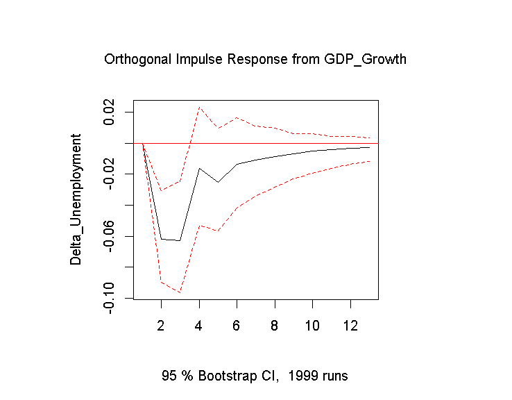
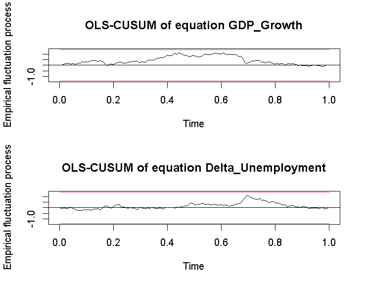
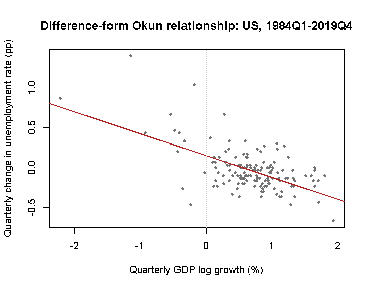
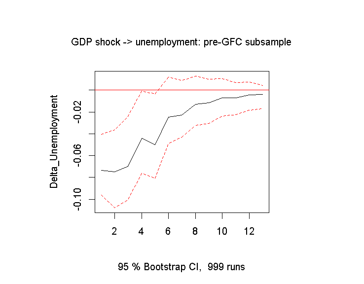
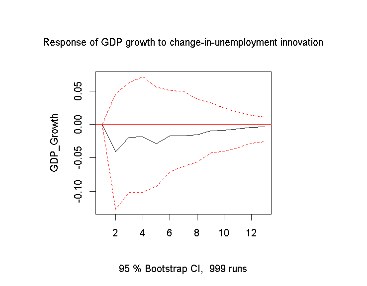

# Output Growth and Unemployment Dynamics in the United States

### A Bivariate VAR Test of Okun's Law, 1984Q1–2019Q4


> **Does output growth *lead* unemployment, or merely move with it?**
> Okun's Law is usually estimated as one static regression. This project models the joint dynamics of real GDP growth and the change in the unemployment rate as a **bivariate vector autoregression**, and tests direction, timing and persistence of the relationship with heteroskedasticity-robust inference.

| | |
|---|---|
| **Author** | Sameer Chawla, MSc Economics (Expected 2027) |
| **Institution** | Gokhale Institute of Politics and Economics (GIPE), Pune |
| **Language** | R (`vars`, `urca`, `sandwich`, `lmtest`, `quantmod`) |
| **Data** | FRED: `GDPC1` (real GDP, quarterly), `UNRATE` (unemployment rate, monthly) |

---

## Headline findings

| # | Finding | Evidence (baseline VAR(3)) |
|---|---|---|
| 1 | **GDP growth Granger-causes changes in unemployment.** | Bootstrap *p* = 0.022 (F = 8.07); HC1-robust Wald *p* = 0.003 |
| 2 | **No feedback from unemployment to GDP growth.** | Bootstrap *p* = 0.749 (F = 0.39); HC1-robust Wald *p* = 0.860 |
| 3 | **A positive growth shock lowers unemployment for about a year.** | One-SD shock: −0.077 pp on impact, trough −0.100 pp at 1 quarter; 95% band excludes zero for horizons 0–4 |
| 4 | **Growth shocks account for a large but identification-dependent share of unemployment variability.** | FEVD share of ΔU at 12 quarters: 44.9% (GDP ordered first) vs 12.6% (reverse); the gap is pinned down by the residual correlation (see §5.6) |
| 5 | **The contemporaneous Okun coefficient is stable and precisely estimated.** | β = −0.273, Newey–West *t* = −3.97, 95% CI [−0.408, −0.139] |

The asymmetry in (1)–(2) survives lag choice, robust inference, a pre-crisis subsample and crisis dummies (§5.8). Granger causality is predictive precedence, **not** structural causation; §6 states what the design can and cannot identify.

---

## Contents

1. [Research question](#1-research-question)
2. [Data](#2-data)
3. [Model and identification](#3-model-and-identification)
4. [Empirical pipeline](#4-empirical-pipeline)
5. [Results](#5-results)
6. [Limitations](#6-limitations)
7. [Reproducing the results](#7-reproducing-the-results)
8. [Repository structure](#8-repository-structure)
9. [References](#9-references)

---

## 1. Research question

Okun (1962) documented a negative relationship between output growth and changes in unemployment. A static regression of $\Delta u_t$ on $g_t$ cannot say whether output *leads* unemployment, whether unemployment feeds back onto output, or how long effects persist. A VAR treats both series as endogenous and answers all three.

**Research question.** Is the inverse Okun relationship a genuine, temporally ordered dynamic in US data? Specifically: (i) does GDP growth Granger-cause changes in unemployment, (ii) is the reverse channel absent, and (iii) is the pattern robust to lag order, identification ordering, inference method and the 2008–09 crisis?

---

## 2. Data

- **Source:** FRED, retrieved with `quantmod`. `GDPC1` (real GDP, quarterly) and `UNRATE` (civilian unemployment rate, monthly, aggregated to quarterly means).
- **Sample:** 1984Q1–2019Q4, **144 quarterly observations**. The start follows the early-1980s disinflation and matches the conventional start of the Great Moderation. The sample ends before COVID-19, whose 2020Q2 collapse (unemployment up roughly 9 percentage points, real GDP down roughly 9% in one quarter) would dominate the covariance structure of a linear VAR.
- **Transformations:**

$$g_t = 100\,[\ln \mathrm{GDP}_t - \ln \mathrm{GDP}_{t-1}], \qquad \Delta u_t = u_t - u_{t-1}$$

| Variable | Mean | SD | Min | Max |
|---|---:|---:|---:|---:|
| `GDP_Growth` (% per quarter) | 0.680 | 0.572 | −2.213 | 1.936 |
| `Delta_Unemployment` (pp) | −0.034 | 0.269 | −0.667 | 1.400 |

Contemporaneous correlation: **−0.581**.



*Figure 1. US GDP growth and change in the unemployment rate, 1984Q1–2019Q4.*

---

## 3. Model and identification

**Reduced-form VAR(p)** with endogenous vector $Y_t = (g_t,\ \Delta u_t)'$:

$$Y_t = c + \sum_{i=1}^{p} A_i\, Y_{t-i} + \varepsilon_t, \qquad \varepsilon_t \sim \mathrm{WN}(0, \Sigma)$$

Written out, the two estimating equations are

$$g_t = c_1 + \sum_{i=1}^{p}\left(\alpha_i\, g_{t-i} + \beta_i\, \Delta u_{t-i}\right) + \varepsilon_{1,t}$$

$$\Delta u_t = c_2 + \sum_{i=1}^{p}\left(\gamma_i\, g_{t-i} + \delta_i\, \Delta u_{t-i}\right) + \varepsilon_{2,t}$$

**Granger causality** tests $H_0\!:\ \beta_1=\dots=\beta_p=0$ (unemployment does not help predict growth) and $H_0\!:\ \gamma_1=\dots=\gamma_p=0$ (growth does not help predict unemployment). These tests do not depend on any ordering of the variables.

**Structural shocks** are identified by a Cholesky factorisation of $\Sigma$ with the baseline ordering **GDP growth → change in unemployment**: output innovations may move unemployment within the quarter, but not vice versa. This is an assumption, not a test; §5.6 and §5.8 show exactly which results depend on it.

---

## 4. Empirical pipeline

| Stage | What is done | Why |
|---|---|---|
| 1. Stationarity | ADF, Phillips–Perron, KPSS (two bandwidths each for PP and KPSS) | Opposite nulls; agreement across tests is the standard of evidence |
| 2. Lag order | `VARselect` (AIC, HQ, SC, FPE), then a **common-sample audit** of VAR(1)–VAR(4) | Lag-length comparisons are invalid if models use different effective samples |
| 3. Estimation and diagnostics | Breusch–Godfrey, Jarque–Bera, multivariate ARCH-LM, companion roots, OLS-CUSUM | Decide which inference is trustworthy |
| 4. Causality | Classical F, **bootstrap F** (4,999 replications), **HC1-robust Wald** | Residuals are non-normal and heteroskedastic, so classical *p*-values cannot be taken at face value |
| 5. Dynamics | Orthogonalised IRFs with 95% bootstrap bands (1,999 replications), FEVD | Timing, persistence and variance attribution |
| 6. Robustness | Reverse ordering, lag sensitivity, pre-GFC subsample, GFC impulse dummies | Is the result an artefact of a modelling choice? |
| 7. Benchmark | Static difference-form Okun regression with Newey–West errors | Anchors the VAR to the classical estimate |

---

## 5. Results

### 5.1 Stationarity

| Series | ADF τ (5% crit. −2.88) | PP Z-τ, short / long (5% crit. −2.88) | KPSS, short / long (5% crit. 0.463) |
|---|---:|---:|---:|
| `GDP_Growth` | −5.162 | −8.275 / −8.652 | 0.486 / 0.349 |
| `Delta_Unemployment` | −3.545 | −5.396 / −5.409 | 0.113 / 0.083 |

Both series reject a unit root under ADF and PP (ADF τ is below the 1% critical value of −3.46 in each case), and KPSS does not reject stationarity for `Delta_Unemployment` at either bandwidth. For `GDP_Growth`, KPSS is borderline: 0.486 at the short bandwidth exceeds the 5% value, and 0.349 at the long bandwidth sits at the 10% value (0.347). Two further points on reading these results:

- The AIC-selected ADF lag order for `Delta_Unemployment` hit the maximum of 8, so PP (which corrects non-parametrically) is the more reliable corroboration for that series.
- Taken together, the evidence supports treating both series as I(0) with moderate persistence, as expected for a growth rate and a first-differenced rate. It does not support the stronger claim that every test is unambiguous.

### 5.2 Lag-order selection: an audited choice

Information criteria disagree: **AIC and FPE select p = 3; HQ and SC select p = 1.**

| p | AIC | HQ | SC | FPE |
|---:|---:|---:|---:|---:|
| 1 | −4.8788 | **−4.8271** | **−4.7516** | 0.0076 |
| 2 | −4.8869 | −4.8007 | −4.6748 | 0.0075 |
| 3 | **−4.8896** | −4.7689 | −4.5927 | **0.0075** |
| 4 | −4.8731 | −4.7179 | −4.4912 | 0.0077 |

Residual diagnostics change with *p*, but comparing models fitted to different effective samples is misleading, because `vars::VAR()` drops *p* observations. The table below re-estimates VAR(1)–VAR(4) on the **same 138 quarters**:

| Model | *n* | Breusch–Godfrey *p* | ARCH-LM *p* | Max root | Granger GDP→ΔU (classical / HC1) | Granger ΔU→GDP (classical / HC1) |
|---|---:|---:|---:|---:|---:|---:|
| VAR(1) | 138 | 0.0055 | 4.5e−08 | 0.679 | 4.7e−04 / 0.016 | 0.045 / 0.070 |
| VAR(3) | 138 | 0.0665 | 3.6e−05 | 0.806 | 4.4e−05 / 0.003 | 0.774 / 0.860 |
| VAR(4) | 138 | 0.0658 | 3.6e−06 | 0.697 | 9.7e−05 / 0.001 | 0.892 / 0.938 |

**Decision: VAR(3) is the baseline.** It minimises AIC and FPE, is more parsimonious than VAR(4), and on the common sample VAR(3) and VAR(4) are indistinguishable on serial correlation (*p* = 0.067 vs 0.066). VAR(1), the SC choice, is rejected outright by the Breusch–Godfrey test. Choosing VAR(4) merely because its full-sample Breusch–Godfrey *p*-value clears 0.05 (0.104 on 140 observations, versus 0.044 for VAR(3) on 141) would be fitting to a diagnostic that is itself sample-dependent. VAR(4) is retained as a cross-check throughout.

### 5.3 Baseline VAR(3): estimates and diagnostics

Estimation sample: 141 quarters (1984Q4–2019Q4 after lags). Selected coefficients:

| Equation | Regressor | Estimate | *t* |
|---|---|---:|---:|
| ΔU | GDP growth, lag 1 | −0.133 | −4.10 |
| ΔU | GDP growth, lag 3 | +0.094 | 2.79 |
| ΔU | ΔU, lag 1 | +0.413 | 4.53 |
| GDP | GDP growth, lag 1 | +0.249 | 2.60 |
| GDP | ΔU (all lags) | jointly insignificant | see §5.4 |

*R*² is 0.581 for the unemployment equation and 0.188 for the growth equation. The residual correlation is **−0.440**.

| Diagnostic | Statistic | *p*-value | Reading |
|---|---:|---:|---|
| Breusch–Godfrey (8 lags) | χ²(32) = 46.79 | 0.044 | Marginal rejection |
| Jarque–Bera (multivariate) | χ²(4) = 75.75 | 1.3e−15 | Non-normal |
| ... skewness component | χ²(2) = 17.25 | 1.8e−04 | |
| ... kurtosis component | χ²(2) = 58.50 | 2.0e−13 | **Fat tails dominate** |
| ARCH-LM (2 lags, multivariate) | χ²(18) = 53.56 | 2.1e−05 | Conditional heteroskedasticity |
| Stability | max companion root = 0.808 | n/a | Stable (all roots inside the unit circle) |


*Figure 2. OLS-CUSUM stability test for both VAR(3) equations.*

**Consequence for inference.** Non-normality and ARCH make classical F-test *p*-values unreliable, so every causality result below is reported with a bootstrap *p*-value and an HC1-robust Wald test alongside the classical one. OLS coefficient estimates remain consistent under these departures.

### 5.4 Granger and instantaneous causality

| Direction | F | Classical *p* | Bootstrap *p* (4,999) | HC1 Wald χ²(3) | HC1 *p* |
|---|---:|---:|---:|---:|---:|
| GDP growth → ΔU | 8.071 | < 0.001 | **0.022** | 13.87 | **0.003** |
| ΔU → GDP growth | 0.385 | 0.764 | **0.749** | 0.756 | **0.860** |

The classical *p*-value for GDP → ΔU is several orders of magnitude smaller than the bootstrap *p*-value. That gap is the cost of ignoring heteroskedasticity, and it is why the bootstrap and HC1 results, not the classical ones, are the headline. Even on the conservative measures the conclusion is the same: **growth helps predict unemployment; unemployment does not help predict growth.**

Same-quarter co-movement is strong: the residual correlation is −0.44, and the instantaneous-causality test rejects zero contemporaneous correlation (χ²(1) = 23.79, *p* = 1.1e−06, VAR(4) specification). This is the contemporaneous association Okun originally documented; the Granger result adds the temporal ordering.

One honest caveat: in VAR(1) only, ΔU → GDP is borderline (classical *p* = 0.045, HC1 *p* = 0.070). VAR(1) is a misspecified model (§5.2), and the effect vanishes at every *p* ≥ 2 (classical *p* from 0.60 to 0.95), so it does not threaten the one-way reading.

### 5.5 Impulse responses

Response of ΔU to a one-standard-deviation GDP-growth shock (≈ 0.52 pp of quarterly growth), baseline ordering, 95% bootstrap band:

| Horizon (quarters) | Response (pp) | 95% band | Excludes 0 |
|---:|---:|---:|:---:|
| 0 | −0.077 | [−0.107, −0.040] | ✓ |
| 1 | −0.100 | [−0.135, −0.060] | ✓ |
| 2 | −0.098 | [−0.134, −0.054] | ✓ |
| 3 | −0.045 | [−0.081, −0.002] | ✓ |
| 4 | −0.048 | [−0.080, −0.007] | ✓ |
| 5 | −0.032 | [−0.061, 0.004] | |
| 8 | −0.016 | [−0.038, 0.002] | |
| 12 | −0.007 | [−0.021, 0.001] | |

The response is negative, builds for two quarters and is statistically distinguishable from zero for **one year**; thereafter the point estimates decay toward zero. Because ΔU is a change, responses cumulate to the *level* of the unemployment rate: the point estimates sum to about **−0.37 pp over the first five quarters** and about −0.50 pp over thirteen (bands for the cumulative response are not computed).


*Figure 3. Response of the change in unemployment to a one-SD GDP-growth shock (VAR(3), Cholesky, 95% bootstrap band).*


*Figure 4. Response of GDP growth to a one-SD unemployment-change shock. Under the baseline ordering the impact response is zero by construction; read it together with the Granger result in §5.4, not as an independent directional effect.*

### 5.6 Forecast-error variance decomposition

| Horizon | GDP growth: own shock | ΔU: GDP shock | ΔU: own shock |
|---:|---:|---:|---:|
| 1 | 100.0% | 19.3% | 80.7% |
| 3 | 99.3% | 44.3% | 55.7% |
| 8 | 98.7% | 44.9% | 55.1% |
| 12 | 98.6% | 44.9% | 55.1% |

GDP growth is almost entirely self-driven (unemployment shocks explain only 1.4% of its forecast-error variance at 12 quarters), while GDP shocks explain about 45% of the forecast-error variance of ΔU from the third quarter onward.

**This share depends on the ordering, and exactly how is worth stating.** With unemployment ordered first the GDP share is only 12.6% at 12 quarters (it is 0% on impact). The two orderings bracket the answer. The reason is mechanical: the one-step share under GDP-first equals the squared residual correlation, 0.440² = 0.193 = **19.3%**, which is the portion of ΔU's innovation variance that is *shared* with GDP's innovation. The Cholesky ordering assigns that shared piece entirely to GDP (baseline) or entirely to unemployment (reverse). Without extra identifying information, the data cannot say which. The honest summary is "between roughly 13% and 45%", with 45% the upper bound that rests on the baseline ordering.



*Figure 5. Forecast-error variance decomposition, baseline ordering.*

### 5.7 Static benchmark: difference-form Okun regression

$$\Delta u_t = \alpha + \beta\, g_t + e_t$$

| Coefficient | Estimate | OLS s.e. | Newey–West s.e. (4 lags) | *t* (HAC) | 95% CI (HAC) |
|---|---:|---:|---:|---:|---:|
| α | 0.152 | 0.029 | 0.069 | 2.19 | [0.016, 0.287] |
| β | **−0.273** | 0.032 | 0.069 | **−3.97** | [−0.408, −0.139] |

*R*² = 0.338. A one-percentage-point increase in quarterly growth is associated with a 0.27 pp lower change in the unemployment rate in the same quarter. The Newey–West standard error is more than twice the OLS one, which signals positively autocorrelated residuals; the static model's OLS inference would have been overconfident. The implied growth rate consistent with a stable unemployment rate is −α/β ≈ 0.55% per quarter (about 2.2% annualised). β is a contemporaneous association, not a causal effect.



*Figure 6. Difference-form Okun relationship, US 1984Q1–2019Q4.*

### 5.8 Robustness

**Reverse Cholesky ordering.** Placing unemployment first changes the *magnitude* of the GDP → ΔU response but not its sign or persistence. In the VAR(4) run the peak response falls from −0.101 pp to −0.063 pp and the impact response is zero by construction; the long-horizon FEVD share falls from 44.9% to 12.6% under VAR(3) (§5.6). The Granger result, which does not depend on ordering, is unchanged. The *direction* of the result is therefore robust to ordering, while the *size* is not.


*Figure 7. GDP shock → ΔU under the reverse ordering (VAR(3)).*

**Lag sensitivity** (common 138-quarter sample, one-SD GDP shock, response of ΔU):

| Model | Impact | Trough | Quarters with 95% band excluding 0 |
|---|---:|---:|---|
| VAR(1) | −0.082 | −0.108 (h = 1) | 0–8 |
| VAR(3) | −0.078 | −0.102 (h = 1) | 0–4 |
| VAR(4) | −0.079 | −0.102 (h = 1, 2) | 0–3 |

The impact response (≈ −0.08 pp) and trough (≈ −0.10 to −0.11 pp) are essentially the same across lag orders. Only the *significance horizon* varies, with the better-specified models giving wider bands than the misspecified VAR(1).

**Pre-crisis subsample and crisis dummies** (VAR(4) specification; the lag order at which the full-sample Breusch–Godfrey test first clears):

| Specification | Breusch–Godfrey *p* | Jarque–Bera *p* | ARCH-LM *p* |
|---|---:|---:|---:|
| Full sample VAR(4) | 0.104 | < 0.001 | < 0.001 |
| Pre-GFC (1984Q1–2007Q4; 96 quarters, 92 effective) | 0.295 | 0.307 | 0.399 |
| Full sample + impulse dummies (2008Q4, 2009Q1) | 0.030 | 0.341 | 0.254 |

Restricting to the pre-crisis period yields a VAR that passes all three diagnostics, so the non-normality and ARCH effects are concentrated in the 2008–09 window and do not indicate generic misspecification. The Granger pattern is preserved there: GDP → ΔU *F* = 3.52, *p* = 0.009; ΔU → GDP *F* = 1.71, *p* = 0.150. Impulse dummies restore normality and homoskedasticity, but serial correlation then re-appears (*p* = 0.030), so the dummy model is a **partial** fix, not a complete one.



*Figure 8. GDP shock → ΔU, pre-GFC subsample.*



*Figure 9. GDP shock → ΔU across lag orders, common sample.*

---

## 6. Limitations

1. **Non-normal, conditionally heteroskedastic residuals.** The baseline fails Jarque–Bera (driven by kurtosis) and ARCH-LM. This is mitigated by bootstrap and HC1-robust causality tests, but the IRF bands come from a residual bootstrap and should be read as approximate. A GARCH-in-VAR or regime-switching model is the natural extension if the crisis period is to be modelled rather than excluded or dummied out.
2. **Marginal residual serial correlation.** Breusch–Godfrey gives *p* = 0.044 for VAR(3) on the full sample (0.067 on the common sample). The result is stable at VAR(4), where the diagnostic clears, but the dependence on the test's sample is a reminder that a VAR is an approximation.
3. **Two-variable information set.** Labour-force participation, productivity, and monetary or fiscal policy are omitted. If a third variable drives both series, a bivariate Cholesky ordering cannot separate it from bilateral transmission. Adding the policy rate or productivity is the most direct extension.
4. **Recursive identification.** The baseline ordering is economically motivated but untested, and §5.6 shows it governs the *size* of the variance attribution. Agnostic schemes such as sign restrictions would give a more defensible range.
5. **Granger causality is predictive.** It establishes temporal precedence conditional on the information set, not structural causation.
6. **Sample truncation.** The model is silent on 2020 onward. Extending it requires an outlier-robust treatment of 2020Q2.
7. **Data vintage.** `GDPC1` is revised, so re-running later may change numbers slightly. Software versions are printed by the script.

---

## 7. Reproducing the results

**Requirements:** R ≥ 4.5.0 and an internet connection (FRED is queried live). Tested with `quantmod` 0.4.29, `zoo` 1.8.14, `urca` 1.3.4, `vars` 1.6.1; `sandwich` and `lmtest` are also required.

```r
install.packages(c("quantmod", "zoo", "urca", "vars", "sandwich", "lmtest"))
source("Okun_Law_Bivariate_VAR.R")
```

The script fetches the data, runs every stage above, and writes all figures (`.png`) and tables (`.csv`) to `output/`. The random seed is fixed (`20261020`), so bootstrap results are reproducible given the same data vintage.

**Runtime.** The bootstrap steps dominate. For a quick test run, lower `GRANGER_BOOT` and `IRF_RUNS` at the top of the script (for example to 199).

**A note on the code.** `vars::irf()` with `boot = TRUE` re-evaluates the stored VAR call, so lag orders are passed as literal integers (`p = 3L`) rather than through a variable. This is deliberate and documented in the script header.

---

## 8. Repository structure

```
.
├── README.md
├── LICENSE
├── Okun_Law_Bivariate_VAR.R
└── output/
    ├── 01_series.png
    ├── 02_cusum.png
    ├── 03_irf_gdp_to_unemployment.png
    ├── 04_irf_unemployment_to_gdp.png
    ├── 05_fevd.png
    ├── 06_irf_reverse_ordering.png
    ├── 07_irf_pre_gfc.png
    ├── 08_okun_scatter.png
    ├── 09_lag_sensitivity_irf.png
    └── table_*.csv
```

The figures in this README load from `output/`, so that folder must be committed.

---

## 9. References

- Breusch, T. S. (1978). Testing for autocorrelation in dynamic linear models. *Australian Economic Papers*, 17(31), 334–355.
- Dickey, D. A., & Fuller, W. A. (1979). Distribution of the estimators for autoregressive time series with a unit root. *Journal of the American Statistical Association*, 74(366a), 427–431.
- Engle, R. F. (1982). Autoregressive conditional heteroscedasticity with estimates of the variance of United Kingdom inflation. *Econometrica*, 50(4), 987–1007.
- Granger, C. W. J. (1969). Investigating causal relations by econometric models and cross-spectral methods. *Econometrica*, 37(3), 424–438.
- Kwiatkowski, D., Phillips, P. C. B., Schmidt, P., & Shin, Y. (1992). Testing the null hypothesis of stationarity against the alternative of a unit root. *Journal of Econometrics*, 54(1–3), 159–178.
- Lütkepohl, H. (2005). *New Introduction to Multiple Time Series Analysis*. Springer.
- Newey, W. K., & West, K. D. (1987). A simple, positive semi-definite, heteroskedasticity and autocorrelation consistent covariance matrix. *Econometrica*, 55(3), 703–708.
- Okun, A. M. (1962). Potential GNP: its measurement and significance. *Proceedings of the Business and Economic Statistics Section, American Statistical Association*, 98–104.
- Phillips, P. C. B., & Perron, P. (1988). Testing for a unit root in time series regression. *Biometrika*, 75(2), 335–346.
- Sims, C. A. (1980). Macroeconomics and reality. *Econometrica*, 48(1), 1–48.

---

<sub>MSc Economics · Gokhale Institute of Politics and Economics · Pune, India · Released under the MIT License</sub>
