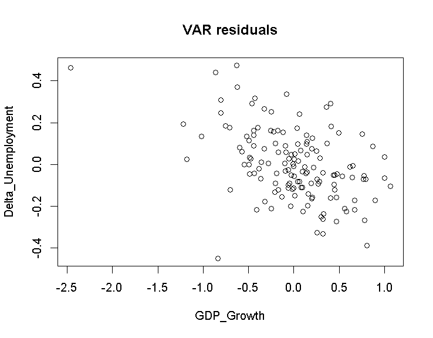

# Output Growth and Unemployment Dynamics in the United States

**A bivariate vector autoregression assessment of Okun's Law, 1984Q1–2019Q4**

**Author:** Sameer Chawla  
**Programme:** MSc Economics, Gokhale Institute of Politics and Economics (GIPE), Pune  
**Methods:** Difference-form Okun regression, VAR, Granger predictability, impulse-response functions (IRFs), forecast-error variance decomposition (FEVD)  
**Code:** [`Okun_Law_Bivariate_VAR.R`](Okun_Law_Bivariate_VAR.R) · **Data:** [FRED GDPC1](https://fred.stlouisfed.org/series/GDPC1) and [FRED UNRATE](https://fred.stlouisfed.org/series/UNRATE)

> **Headline result.** Quarterly real GDP growth is negatively associated with quarterly changes in the US unemployment rate over 1984–2019. In the **AIC/FPE-selected VAR(3)**, lagged GDP growth contains information useful for predicting changes in unemployment, whereas lagged unemployment changes do not show corresponding predictive content for GDP growth. An orthogonalized GDP-growth innovation is associated with a negative short-run response in unemployment changes. **These are conditional predictive and recursively identified results—not proof of structural causation.** The baseline residuals exhibit serial correlation, non-normality and ARCH effects; the FEVD is sensitive to the Cholesky ordering.

## At a glance

| Analysis | Main result |
|---|---|
| Sample | 1984Q1–2019Q4; 144 quarters before VAR lagging |
| Static difference-form Okun slope | **−0.2734**; Newey–West HAC SE **0.0688**; p = **0.000112** |
| Information criteria | AIC/FPE choose **3 lags**; HQ/BIC choose **1 lag** |
| Reported baseline | **Bivariate VAR(3)** with intercept; **141** effective observations |
| GDP growth → unemployment changes | Wild-bootstrap Granger **F = 8.071**, p = **0.0224** (4,999 runs) |
| Unemployment changes → GDP growth | Wild-bootstrap Granger **F = 0.385**, p = **0.7491** (4,999 runs) |
| Unemployment-change IRF to GDP innovation | **−0.1004 pp** after one quarter; pointwise bootstrap CI **[−0.1346, −0.0597]** |
| GDP contribution to 12-quarter unemployment-change FEVD | **44.86%** (GDP-first) vs **12.56%** (unemployment-first) |
| Dynamic stability | Maximum companion-eigenvalue modulus **0.8075** (below one) |
| Critical model limitation | VAR(3) residual BG p = **0.0443**, JB p ≈ **1.33 × 10⁻¹⁵**, ARCH-LM p ≈ **2.15 × 10⁻⁵** |

## 1. Research question and scope

**Research question:** Do past values of real GDP growth improve forecasts of changes in the unemployment rate, beyond past unemployment changes, and how do these variables respond over time to recursively orthogonalized innovations?

The project combines a conventional difference-form Okun regression with a reduced-form bivariate VAR. It evaluates contemporaneous association, lagged predictive information and dynamic responses. Its contribution is a **transparent applied comparison**, including lag-order choice, residual diagnostics, sample sensitivity and identification sensitivity; it does not claim to discover a new form of Okun's Law or identify exogenous policy shocks.

The analysis ends in 2019Q4 to exclude the extraordinary COVID-19 observations. This is a sample-design decision, **not evidence of a break in the relationship during 2020**. Likewise, beginning in 1984Q1 narrows the study to an era beginning around the US Great Moderation; it does not imply a formally established break in 1984.

## 2. Data and variable construction

Both source series are seasonally adjusted and obtained from Federal Reserve Economic Data (FRED):

| Variable | FRED code | Source frequency | Construction | Interpretation |
|---|---|---|---|---|
| `GDP_Growth` | [`GDPC1`](https://fred.stlouisfed.org/series/GDPC1) | Quarterly | `100 * diff(log(GDPC1))` | Approximate **quarter-on-quarter percentage** growth; **not annualized** |
| `Delta_Unemployment` | [`UNRATE`](https://fred.stlouisfed.org/series/UNRATE) | Monthly | Arithmetic quarterly mean of three monthly unemployment rates, followed by first difference | Quarterly change in the unemployment rate (**percentage points**) |

With real GDP \(Q_t\) and the quarterly mean unemployment rate \(u_t\),

$$
g_t=100\bigl[\ln Q_t-\ln Q_{t-1}\bigr],
\qquad \Delta u_t=u_t-u_{t-1}.
$$

The script downloads data beginning before the estimation window; **1983Q4** is required to calculate the first 1984Q1 differences. There are **144 transformed quarterly observations** from 1984Q1–2019Q4. The VAR(3) has **141** effective observations after lagging.

| Statistic | GDP growth (%) | Change in unemployment (pp) |
|---|---:|---:|
| Mean | 0.6801 | −0.0343 |
| Standard deviation | 0.5723 | 0.2691 |
| Minimum | −2.2133 | −0.6667 |
| Maximum | 1.9359 | 1.4000 |

The contemporaneous Pearson correlation is **−0.5814**. Correlation is descriptive, not evidence of structural causation.


*Figure 1. Quarterly US real GDP growth and change in the unemployment rate, 1984Q1–2019Q4. The pronounced 2008–09 movements motivate, but do not by themselves validate, the crisis sensitivity checks.*

## 3. Econometric specification

### Static difference-form Okun benchmark

$$
\Delta u_t=\alpha+\beta g_t+e_t,
$$

estimated by OLS. For statistical inference, standard errors are Newey–West HAC with **four lags, no prewhitening**, and small-sample adjustment. This is an unconditional contemporaneous linear projection, not a structural causal equation.

### Reduced-form VAR

$$
\mathbf y_t=\mathbf c+\sum_{j=1}^{p}A_j\mathbf y_{t-j}+\boldsymbol\varepsilon_t,
\qquad
\mathbf y_t=\begin{bmatrix}g_t\\Delta u_t\end{bmatrix},
\qquad
E(\boldsymbol\varepsilon_t\boldsymbol\varepsilon_t')=\Sigma.
$$

Each equation includes lags of **both** endogenous variables and an intercept. The script estimates the **full-sample VAR(3)** by OLS. The lag-order and specification trade-offs below are central to the interpretation.

### Recursive orthogonalization

IRFs and FEVD use the Cholesky factorization \(\Sigma=PP'\). In the baseline ordering, `GDP_Growth` comes before `Delta_Unemployment`. This normalization allows the first recursively identified innovation to affect both variables contemporaneously but imposes a **zero on-impact GDP response to the second innovation**. Reversing the variable ordering imposes a different zero restriction and defines **different innovations**. Such restrictions are identification assumptions, not implications of Granger causality.

## 4. Stationarity tests and lag selection

### ADF, Phillips–Perron and KPSS

ADF: drift specification, AIC selection from up to eight augmentation lags. PP: constant specification, `Z-tau`, short and long bandwidths. KPSS: level-stationarity null, short and long bandwidths.

| Test statistic | GDP growth | Δ unemployment | 5% critical value |
|---|---:|---:|---:|
| ADF | −5.1624 | −3.5448 | −2.8800 |
| Phillips–Perron, short | −8.2749 | −5.3958 | −2.8817 |
| Phillips–Perron, long | −8.6524 | −5.4091 | −2.8817 |
| KPSS, short | **0.4861** | 0.1134 | 0.4630 |
| KPSS, long | 0.3486 | 0.0827 | 0.4630 |

ADF and both PP bandwidth choices reject their **unit-root null** for both transformed variables at 5%. Long-bandwidth KPSS **fails to reject level stationarity** in both series. **Short-bandwidth KPSS rejects stationarity for GDP growth** (0.4861 > 0.4630). Therefore, evidence broadly supports estimating a VAR in the transformed series, **with a genuine KPSS bandwidth sensitivity**. These results do **not** establish the exact integration order of the untransformed level series.

### Lag-order choice

`vars::VARselect` compares lags 1–6 on a common effective sample:

| Information criterion | Selected lag |
|---|---:|
| Akaike (AIC) | **3** |
| Final prediction error (FPE) | **3** |
| Hannan–Quinn (HQ) | 1 |
| Schwarz / BIC | 1 |

The code designates **VAR(3)** as its *information-criterion baseline*. This is **not** a claim that VAR(3) passes every diagnostic. Its full-sample 8-lag Breusch–Godfrey test rejects the null of no residual serial correlation at the 5% level (p = **0.0443**). VAR(4) does **not** reject in its full-sample counterpart (p = **0.1036**), but failure to reject does not prove white-noise errors. These models have different usable full-sample lengths (141 and 140), so the script also performs comparisons on a **common effective 138-quarter sample**. VAR(4) is an important competing specification.

## 5. Empirical results

### 5.1 Conventional Okun regression

$$
\widehat{\Delta u_t}=0.1517-0.2734g_t.
$$

| Statistic | Reported result |
|---|---:|
| GDP-growth slope | −0.27339 |
| Newey–West HAC standard error | 0.06879 |
| HAC t statistic | −3.9741 |
| HAC p value | 0.000112 |
| Approximate 95% HAC confidence interval | [−0.4082, −0.1386] |
| OLS \(R^2\) | 0.3380 |

An additional percentage point of **quarterly** real GDP growth is associated with a **0.273-percentage-point smaller quarterly change** in unemployment, on average. The coefficient is not the impact of a policy-induced output intervention.


*Figure 2. Scatterplot of quarterly GDP growth and unemployment-rate changes. The fitted line is OLS; inference in the table uses Newey–West HAC standard errors.*

### 5.2 Granger predictability

Full-sample VAR(3), `vars::causality(..., boot = TRUE, boot.runs = 4999)`:

| Null hypothesis | F | Wild-bootstrap p | Decision at 5% |
|---|---:|---:|---|
| Lagged GDP growth does not Granger-predict \(\Delta u_t\) | 8.0710 | **0.0224** | Reject |
| Lagged \(\Delta u_t\) does not Granger-predict GDP growth | 0.3852 | **0.7491** | Do not reject |

The asymmetry concerns **predictive information conditional on these two observed variables, this lag order and this historical sample**. It does **not** prove that an independently manipulable GDP shock causes unemployment to change or rule out broader economic feedback. The script also prints classical F tests and HC1 Wald tests; the latter allow for certain forms of heteroskedasticity but are **not generally robust to remaining serial correlation**.

### 5.3 Orthogonalized impulse responses

A positive **one-standard-deviation GDP-growth Cholesky innovation** yields the following response of the **change** in unemployment (percentage points). Intervals are *pointwise 95% residual-bootstrap percentiles* based on **1,999 replications**:

| Horizon (quarters; 0 = impact) | Point response (pp) | 95% bootstrap interval (pp) |
|---|---:|---|
| 0 | −0.0769 | [−0.1075, −0.0402] |
| 1 | **−0.1004** | **[−0.1346, −0.0597]** |
| 2 | −0.0979 | [−0.1340, −0.0538] |
| 3 | −0.0455 | [−0.0806, −0.0023] |
| 4 | −0.0476 | [−0.0799, −0.0074] |
| 5 | −0.0318 | [−0.0613, 0.0044] |
| 12 | −0.0068 | [−0.0210, 0.0010] |

The intervals exclude zero **pointwise at horizons 0–4**; from horizon 5 onward, zero lies inside the reported bands. A negative response of \(\Delta u_t\) is **not the same thing as a −0.10 percentage-point level response of unemployment**. The estimated impulse responses and the bootstrap bands are conditional on the recursively identified innovation and model assumptions.


*Figure 3. Baseline VAR(3) orthogonalized response to a GDP-growth innovation. Pointwise 95% bootstrap bands.*

### 5.4 Forecast-error variance decomposition

FEVD attributes **forecast-error variance**, not realised movements. With GDP growth ordered first:

| Forecast horizon | GDP shock contribution to \(\Delta u\) variance | Own innovation contribution |
|---|---:|---:|
| 1 quarter | 19.32% | 80.68% |
| 3 quarters | 44.33% | 55.67% |
| 12 quarters | **44.86%** | **55.14%** |

At 12 quarters, **98.63%** of the forecast-error variance of **GDP growth** is attributed to its own innovation, and **1.37%** to the recursively identified unemployment-change innovation. These values are conditional on the ordering and the estimated VAR(3).


*Figure 4. Twelve-quarter VAR(3) FEVD shown as 100% stacked shares. The legend is placed outside the bars; bars sum to 100% at each horizon.*

## 6. Residual diagnostics and model limitations

| Diagnostic | Null hypothesis | Full-sample VAR(3) result | Conclusion at 5% |
|---|---|---|---|
| Breusch–Godfrey LM (8 lags) | No residual serial correlation | χ² = 46.791, p = **0.04427** | Reject |
| Multivariate Jarque–Bera | Normal innovations | χ² = 75.751, p = **1.33 × 10⁻¹⁵** | Reject |
| Multivariate ARCH-LM (2 lags) | No ARCH | χ² = 53.560, p = **2.15 × 10⁻⁵** | Reject |
| Companion-matrix roots | All moduli less than one | Maximum = **0.8075** | Dynamically stable |

The OLS-CUSUM paths in the supplementary figure remain inside their displayed boundaries. This is a limited parameter-stability check, **not proof that all types of structural change are absent**. Likewise, a stable companion matrix does not imply white-noise, Gaussian or homoskedastic residuals.

**Inference caveats.** The reported residual serial correlation and ARCH effects are substantial diagnostic failures. HC1 Wald tests account for certain forms of conditional heteroskedasticity but do not automatically handle serial dependence. The wild-bootstrap Granger results are useful additional evidence, not a remedy for a misspecified conditional mean. Standard residual-bootstrap **IRF confidence bands may have inaccurate coverage** in the presence of time-varying volatility and/or misspecified dynamics. All inferential claims therefore remain qualified by these diagnostics. OLS consistency additionally requires appropriate conditional mean and moment conditions; normality is not itself a requirement for OLS consistency.

A richer analysis could assess additional lags, conditionally heteroskedastic errors, alternative robust dynamic inference and omitted macroeconomic variables, but such extensions are **outside this bivariate assignment's scope**.

## 7. Sensitivity checks

### Lag specification

VAR(1), VAR(3) and VAR(4) are re-estimated on a **common 138-quarter effective sample** for comparability. All produce negative initial responses to recursively identified GDP-growth innovations, although their impulse-response persistence and pointwise confidence-band exclusions vary. Full-sample and common-sample BG p-values are **not interchangeable**.


*Figure 5. IRF point estimates across VAR(1), VAR(3) and VAR(4), common estimation period. The comparative plot shows point estimates, not joint uncertainty bands.*

### Reverse Cholesky ordering

Reversing the contemporaneous ordering leaves the **reduced-form predictive coefficients** unchanged apart from relabelling, but changes the identified shocks. The GDP innovation contribution to 12-quarter unemployment-change FEVD decreases from **44.86% (GDP first)** to **12.56% (unemployment first)**. Under the reversed ordering, GDP innovations have a **zero on-impact response of unemployment changes by construction**. The size of the FEVD contribution is thus **strongly identification-sensitive**. Comparing the shapes of separately normalized orthogonalized responses is informative but does not hold a common structural shock fixed.

### Pre-GFC subsample and crisis interventions

The script re-estimates a VAR(3) using observations through **2007Q4**, and separately estimates the full-sample VAR(3) with impulse indicators for **2008Q4 and 2009Q1**. These are sensitivity exercises: neither subsample diagnostics nor crisis dummies establish that the financial crisis was the unique cause of the full-sample failures. The crisis-dummy model is not a structural account of the recession.

### Two-variable information set

The bivariate model omits labour-force participation, productivity, policy and other common macroeconomic drivers. Consequently, a recursive innovation may combine multiple sources of variation and should **not** be labelled an unambiguously exogenous economic shock.

## 8. Supplemental figures

<details>
<summary>Expand: stability, reverse-direction response, alternative identification, pre-GFC response and residual scatter</summary>

**Figure A1. OLS-CUSUM plots, GDP-growth and unemployment-change equations.**


**Figure A2. GDP-growth response to a recursively identified unemployment-change innovation (GDP ordered first).** The zero impact response is imposed by the ordering. The displayed screenshot is from an earlier bootstrap run; re-generate with the consolidated script for the archival VAR(3) result.


**Figure A3. GDP-growth innovation to unemployment-change response under the *reverse* Cholesky ordering.**


**Figure A4. GDP-growth innovation to unemployment changes in the pre-GFC subsample.** This is an earlier sensitivity-plot screenshot; re-generate from the current VAR(3) script before an archival release.


**Figure A5. Scatterplot of VAR(3) reduced-form residuals.** This plot is descriptive; use the formal LM, JB and ARCH tests for diagnostics.



</details>

**Figure provenance note:** The provided numerical tables are from the documented VAR(3) console output. Some uploaded supplementary screenshots were originally produced using **999** bootstrap replications rather than the consolidated script's **1,999**. The graphical bootstrap replication count is printed on each image. **For an archival release, run the script from a clean session and recommit the newly generated `output/` folder** before asserting exact correspondence between every image and table. The numerical FEVD chart above has been redrawn from the reported VAR(3) FEVD table without modifying its shares.

## 9. Replication instructions

### Expected repository layout

```text
US-OKUNS-LAW-VAR/
├── README.md
├── Okun_Law_Bivariate_VAR.R
├── LICENSE
└── output/
    ├── 01_series.png
    ├── 02_cusum.png
    ├── 03_irf_gdp_to_unemployment.png
    ├── 04_irf_unemployment_to_gdp.png
    ├── 05_fevd.png
    ├── 06_irf_reverse_ordering.png
    ├── 07_irf_pre_gfc.png
    ├── 08_okun_scatter.png
    ├── 09_lag_sensitivity_irf.png
    ├── 10_var_residuals.png
    └── table_*.csv   (generated by the R script)
```

### Requirements and execution

Developed with **R 4.5.0 (Windows)** and the packages `quantmod`, `zoo`, `urca`, `vars`, `sandwich` and `lmtest`. To install dependencies and run from the repository root:

```r
install.packages(c("quantmod", "zoo", "urca", "vars", "sandwich", "lmtest"))
source("Okun_Law_Bivariate_VAR.R", echo = TRUE)
```

The script downloads FRED observations, constructs the variables, prints estimates and diagnostics in the console, and creates figures/tables in `output/`. It uses `GRANGER_BOOT <- 4999L` and `IRF_RUNS <- 1999L`; lower counts may be used for debugging only. The random seeds are set in the script. Outputs may differ marginally after FRED revisions and across software versions. `sessionInfo()` is printed at the end of the run.

**Verification checklist:** The script should finish without error and reproduce, to reasonable numerical tolerance, the 144 transformed observations, the selected-lag criteria, the baseline VAR(3) diagnostic values, the Granger results and the FEVD shares reported above. Confirm that each plot actually depicts its filename before uploading. For strict reproducibility independent of new revisions, archive a data snapshot or use a documented fixed vintage through [ALFRED](https://fred.stlouisfed.org/).

**Execution status:** The econometric results were obtained from the user's R console runs. The consolidated source has been reviewed and the figure mapping corrected, but the *full modified script has not been executed independently in R* as part of this package preparation.

## 10. References

- Dickey, D. A., & Fuller, W. A. (1979). Distribution of the estimators for autoregressive time series with a unit root. *Journal of the American Statistical Association, 74*(366), 427–431.
- Enders, W. (2015). *Applied Econometric Time Series* (4th ed.). Wiley.
- Granger, C. W. J. (1969). Investigating causal relations by econometric models and cross-spectral methods. *Econometrica, 37*(3), 424–438.
- Kwiatkowski, D., Phillips, P. C. B., Schmidt, P., & Shin, Y. (1992). Testing the null hypothesis of stationarity against the alternative of a unit root. *Journal of Econometrics, 54*(1–3), 159–178.
- Lütkepohl, H. (2005). *New Introduction to Multiple Time Series Analysis*. Springer.
- Newey, W. K., & West, K. D. (1987). A simple, positive semi-definite, heteroskedasticity and autocorrelation consistent covariance matrix. *Econometrica, 55*(3), 703–708.
- Okun, A. M. (1962). Potential GNP: Its measurement and significance. In *Proceedings of the Business and Economic Statistics Section*, American Statistical Association.
- Pfaff, B. (2008). VAR, SVAR and SVEC models: Implementation within R package vars. *Journal of Statistical Software, 27*(4), 1–32.
- Phillips, P. C. B., & Perron, P. (1988). Testing for a unit root in time series regression. *Biometrika, 75*(2), 335–346.
- [US Bureau of Economic Analysis — Real Gross Domestic Product (GDPC1), FRED](https://fred.stlouisfed.org/series/GDPC1).
- [US Bureau of Labor Statistics — Civilian Unemployment Rate (UNRATE), FRED](https://fred.stlouisfed.org/series/UNRATE).

---

**Scope:** Applied empirical research; findings concern conditional prediction and recursively identified innovations, not verified structural causal effects. See the diagnostic and identification cautions above.
